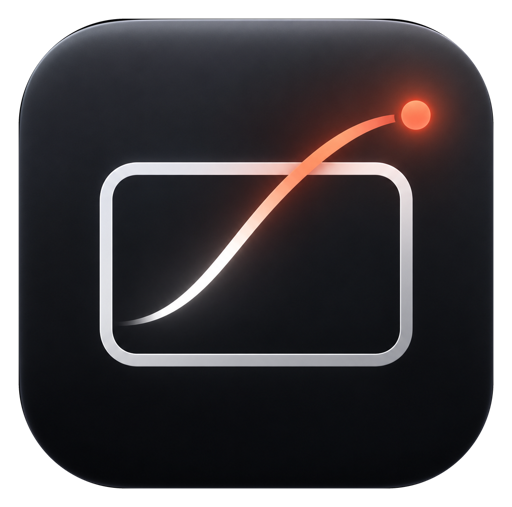
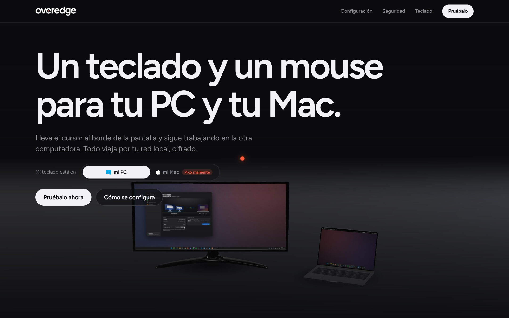
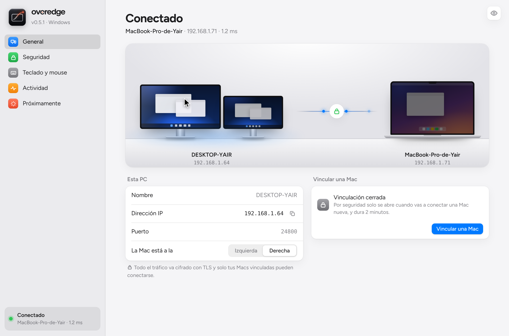

# Overedge

**Un teclado y un mouse para tu PC y tu Mac.** 
Lleva el cursor al borde de la pantalla y sigue trabajando en la otra computadora.

[overedgeapp.com](https://overedgeapp.com) · [Descargar](../../releases/latest) · [Reportar un problema](../../issues/new/choose) · [Proponer una idea](../../issues/new?template=sugerir-idea.yml)

 

 

Este es el espacio de la **comunidad de Overedge**. Aquí encuentras:
- las **descargas** de cada versión;
- el lugar para **reportar problemas** y **proponer ideas**;
- lo que viene en la app.

El código de la app es privado; este repositorio es público para que cualquiera pueda participar.

## Qué es Overedge

Tienes una PC con Windows y una Mac en el mismo escritorio. Con Overedge, cuando el cursor llega al borde de tu monitor **cruza a la otra computadora** como si fuera otra pantalla, y el teclado lo sigue. Regresas por el mismo borde y vuelves.

- **Sin cables ni hardware extra.** Todo viaja por tu red local.
- **Cifrado de punta a punta** con TLS 1.3. Las computadoras se vinculan con un código de 6 dígitos que nunca viaja por la red.
- **Sin cuenta y sin nube.** Fuera de tu casa u oficina, Overedge no responde.
- **Tus monitores como están:** lado a lado, uno encima de otro o desfasados.

  <picture>
    <source media="(prefers-color-scheme: dark)" srcset="docs/app-oscuro.png">
    
  </picture>

## Descargar

Las versiones se publican en **[Releases](../../releases)**.

| Sistema | Archivo | Notas |
|---|---|---|
| **Windows 10 / 11** | `Overedge.exe` | Si SmartScreen avisa: **Más información → Ejecutar de todas formas**. |
| **macOS** (Apple Silicon e Intel) | `Overedge-mac.zip` | La primera vez ábrela con clic derecho → **Abrir**. Después actívala en **Ajustes del Sistema → Privacidad y seguridad → Accesibilidad**. |

**Primeros pasos:**
1. Abre Overedge en las dos computadoras.
2. En la PC, pulsa **Vincular una Mac**.
3. En la Mac, elige tu PC y escribe el código.

## ¿Algo no funciona?

Abre un **[reporte de problema](../../issues/new?template=reportar-problema.yml)**. Ayuda mucho incluir:
- tu versión de Overedge y de cada sistema;
- qué esperabas que pasara y qué pasó;
- si puedes, una captura del registro: pestaña **Actividad** en la app.

Usa el ojito de arriba a la derecha de la app para ocultar tus IPs antes de tomar capturas.

**¿Encontraste una falla de seguridad?** No la publiques aquí. Sigue las instrucciones de [SECURITY.md](SECURITY.md).

## Lo que viene

| | |
|---|---|
| 🚧 **En desarrollo** | Versión nativa más ligera, con ícono en la bandeja de Windows y en la barra de menú de la Mac |
| 🚧 **En desarrollo** | Tu Mac como computadora principal, controlando la PC |
| ⏳ **Próximamente** | Portapapeles compartido |
| ⏳ **Próximamente** | Arrastrar archivos entre computadoras |
| ⏳ **Próximamente** | Ver la pantalla de la Mac en un monitor de Windows |
| ⏳ **Próximamente** | Linux |

¿Te falta algo? [Propón una idea](../../issues/new?template=sugerir-idea.yml). Las ideas con más 👍 suben en la lista.

---

Hecho por <a href="https://yairhdz24.dev">Yair Hernández</a> · © 2026 Overedge

