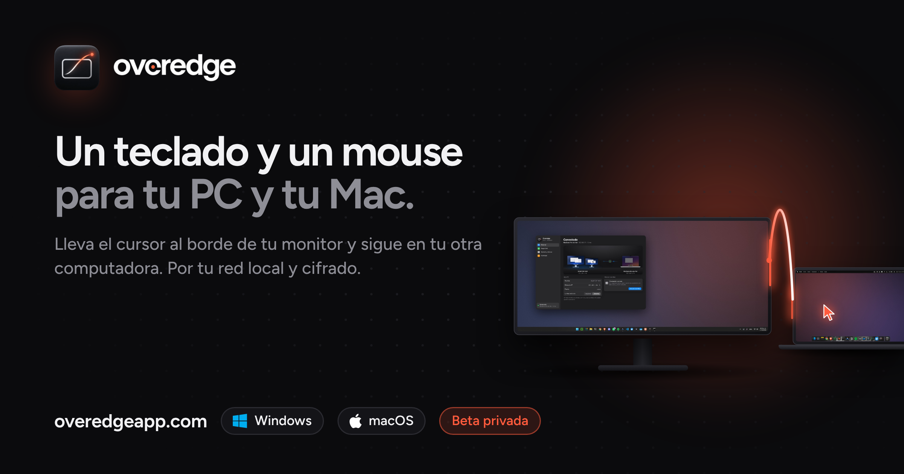
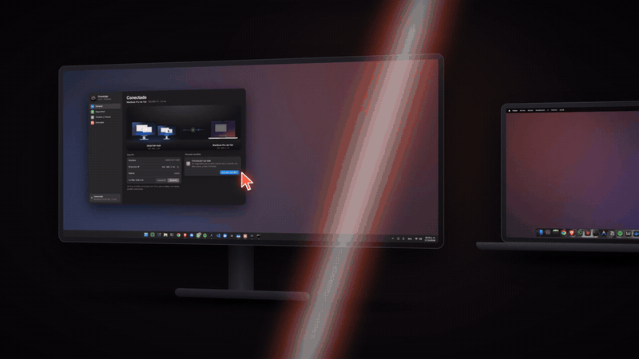
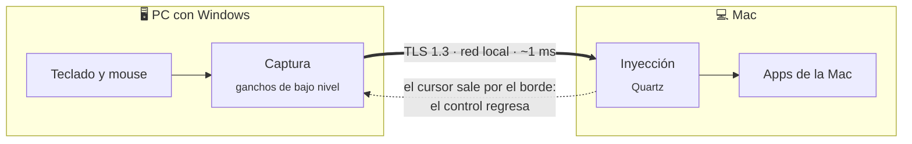
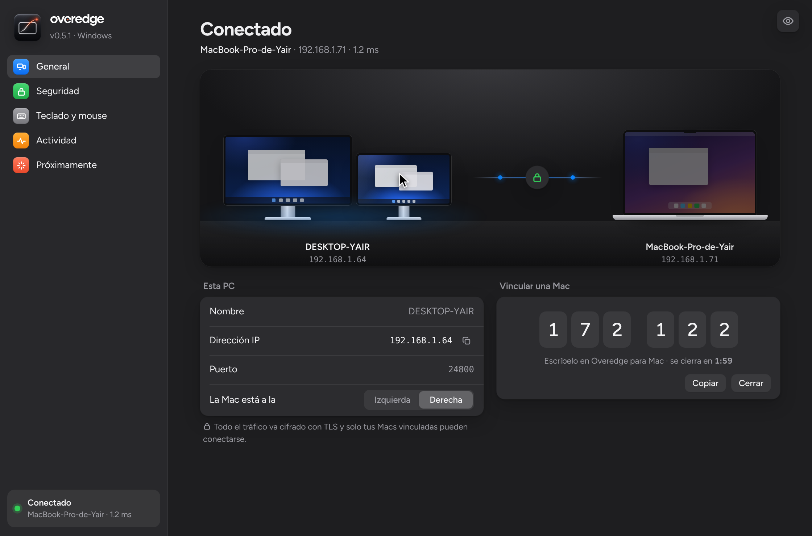
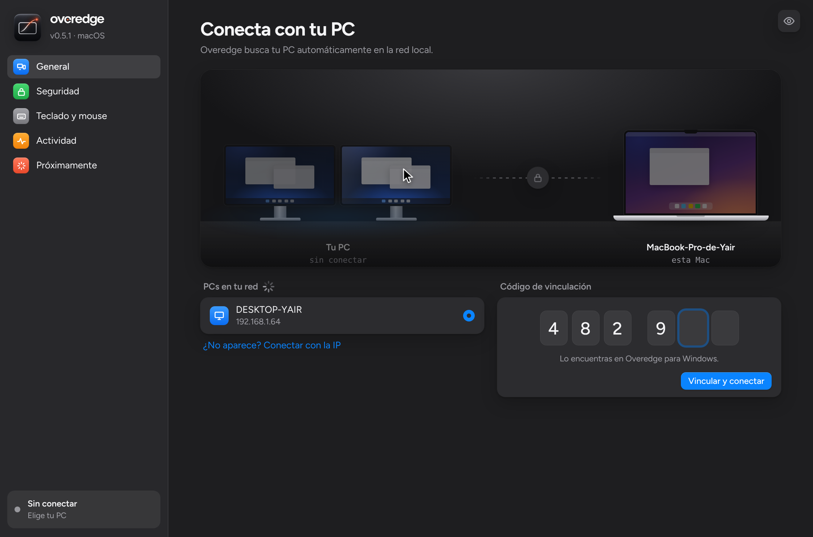
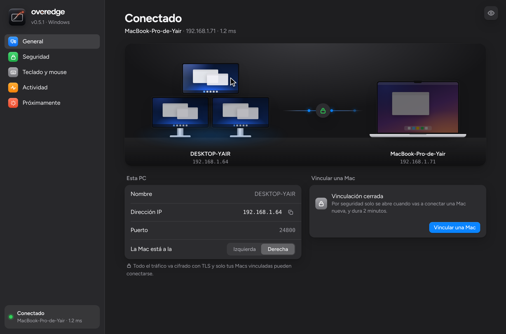
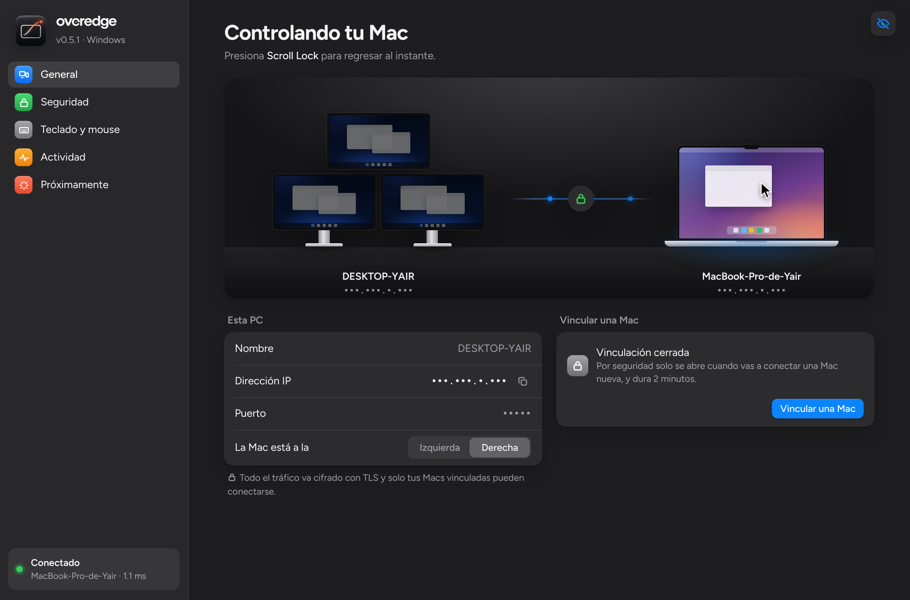
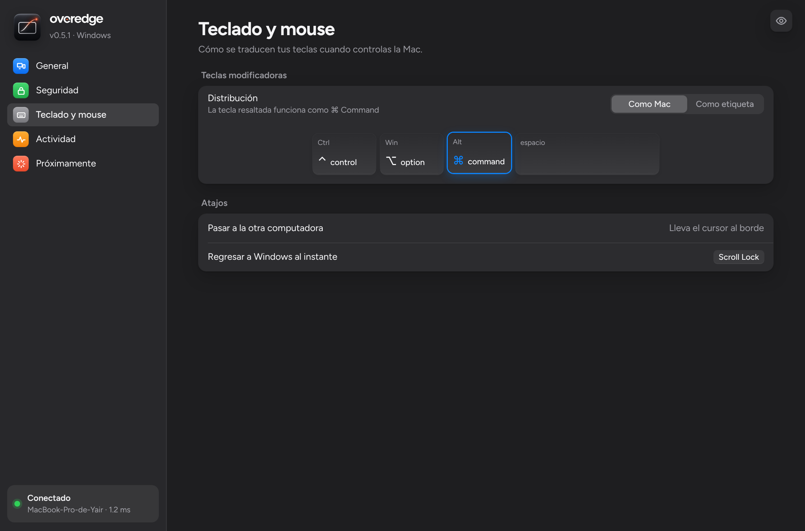
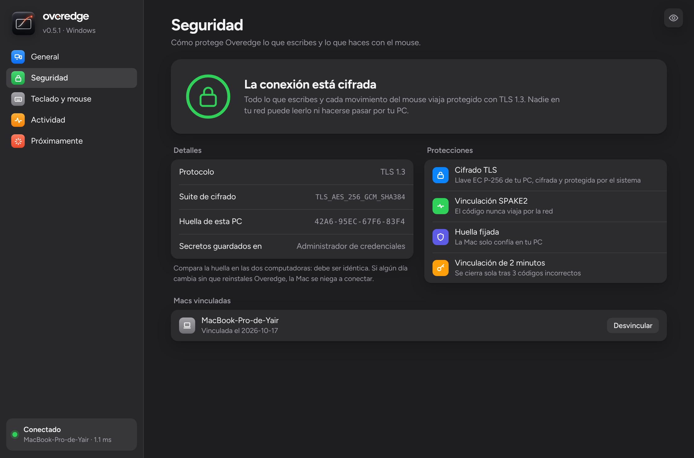

# Overedge

### Un teclado y un mouse para tu PC y tu Mac.

Lleva el cursor al borde de tu monitor y sigue trabajando en la otra computadora. 
Sin cables, sin hardware y sin nube: todo viaja por tu red local, cifrado.

 

 

<a href="#-qué-es">Qué es</a> ·
<a href="#-cómo-funciona">Cómo funciona</a> ·
<a href="#-descargar-e-instalar">Instalar</a> ·
<a href="#-funciones">Funciones</a> ·
<a href="#-seguridad">Seguridad</a> ·
<a href="#-preguntas-frecuentes">Preguntas</a> ·
<a href="#-lo-que-viene">Lo que viene</a> ·
<a href="#-cómo-contribuir">Contribuir</a>

 

> [!NOTE]
> Este es el repositorio **público de la comunidad**: descargas, reportes de problemas, ideas y la hoja de ruta. El código de la app es privado; todo lo demás pasa aquí, a la vista.

 

## ✦ Qué es

Tienes una **PC con Windows** y una **Mac** en el mismo escritorio, y un solo teclado y mouse.

Con Overedge, cuando el cursor llega al borde de tu monitor **cruza a la Mac** como si fuera otra pantalla. El teclado lo sigue: escribes en la Mac con el teclado de tu PC. Regresas por el mismo borde y vuelves a Windows.

<table>
  <tr>
    <td width="33%" valign="top">
      <h4>🖱️ Un solo escritorio</h4>
      Tus dos computadoras se sienten como una sola con varias pantallas. Sin cambiar de teclado, sin botones, sin cables.
    </td>
    <td width="33%" valign="top">
      <h4>🔒 Cifrado de punta a punta</h4>
      Cada tecla y cada movimiento viaja con TLS 1.3. La vinculación usa SPAKE2: el código nunca pasa por la red.
    </td>
    <td width="33%" valign="top">
      <h4>🏠 Solo tu red local</h4>
      Sin cuenta, sin servidores, sin nube. Fuera de tu casa u oficina, Overedge no responde a nadie.
    </td>
  </tr>
</table>

  

  <picture>
    <source media="(prefers-color-scheme: dark)" srcset="docs/app-oscuro.png">
    
  </picture>

## ✦ Cómo funciona

1. **Abre Overedge en las dos computadoras.** La Mac encuentra tu PC sola en la red; no escribes ninguna IP.
2. **Vincúlalas una vez.** La PC muestra un código de 6 dígitos que vence en 2 minutos y lo escribes en la Mac.
3. **Lleva el cursor al borde.** Listo. Desde ahí, la Mac se conecta sola cada vez que abres Overedge.

<table>
  <tr>
    <td width="50%"></td>
    <td width="50%"></td>
  </tr>
  <tr>
    <td align="center"><b>En la PC:</b> el código cambia en cada vinculación y vence en 2 minutos.</td>
    <td align="center"><b>En la Mac:</b> tu PC aparece sola; escribes el código y listo.</td>
  </tr>
</table>

## ✦ Descargar e instalar

Descárgala desde **[overedgeapp.com](https://overedgeapp.com/#descargar)** o directo de **[Releases](../../releases/latest)**. Cada versión trae sus notas y las sumas SHA-256 para verificar los archivos.

| Sistema | Archivo | Requisitos |
|---|---|---|
|  | [`Overedge.exe`](../../releases/latest/download/Overedge.exe) | Windows 10 u 11 |
|  | [`Overedge-mac.zip`](../../releases/latest/download/Overedge-mac.zip) | Mac con Apple Silicon o Intel |

<b>🪟 Instalar en Windows</b>

 

1. Descarga `Overedge.exe` y ábrelo.
2. Si SmartScreen avisa, pulsa **Más información → Ejecutar de todas formas**. La app todavía no tiene firma de código.
3. Cuando Windows pregunte por el **Firewall**, permite el acceso en **redes privadas**. Overedge usa el puerto **TCP 24800** para la conexión cifrada y **UDP 24801** para que la Mac encuentre tu PC.
4. Pulsa **Vincular una Mac** cuando la tengas a la mano.

<b>🍎 Instalar en la Mac</b>

 

1. Descarga `Overedge-mac.zip`, descomprímelo y mueve **Overedge** a **Aplicaciones**.
2. La primera vez ábrela con **clic derecho → Abrir**.
3. Actívala en **Ajustes del Sistema → Privacidad y seguridad → Accesibilidad**. Sin este permiso, macOS no deja que otra app mueva el mouse ni escriba.
4. Elige tu PC de la lista y escribe el código que aparece en Windows.

### Actualizaciones

Overedge te avisa cuando hay una versión nueva: aparece una tarjeta en la barra lateral con el botón **Descargar**. Si usas una beta, también te avisa de las betas nuevas. La app solo consulta las Releases públicas de este repositorio, no envía datos tuyos, y puedes apagarlo en **Seguridad → Buscar actualizaciones**.

¿Quieres enterarte de cada versión sin abrir la app? Pulsa **Watch → Custom → Releases** arriba en este repositorio.

> [!TIP]
> **¿Te quedaste "atrapado" en la Mac?** Pulsa <kbd>Bloq Despl</kbd> (Scroll Lock) en el teclado de la PC y el control regresa a Windows al instante.

## ✦ Funciones

<table>
  <tr>
    <td width="50%" valign="top">
      
      <h4>Tus monitores, como están en tu escritorio</h4>
      Uno, dos o tres monitores: lado a lado, uno encima de otro o desfasados. Overedge los dibuja en su posición real y sabe dónde termina tu escritorio.
    </td>
    <td width="50%" valign="top">
      
      <h4>Modo privado</h4>
      ¿Vas a compartir pantalla? El ojito de arriba a la derecha oculta todas las IPs y puertos, incluido el registro. Se recuerda para la próxima vez.
    </td>
  </tr>
  <tr>
    <td width="50%" valign="top">
      
      <h4>Las teclas quedan donde las esperas</h4>
      En la Mac, <kbd>Alt</kbd> funciona como <kbd>⌘</kbd> y la tecla de Windows como <kbd>⌥</kbd>, en el mismo lugar que en un teclado de Mac. Si prefieres que coincidan las etiquetas, lo cambias con un clic.
    </td>
    <td width="50%" valign="top">
      
      <h4>Seguridad que puedes ver</h4>
      Protocolo, suite de cifrado y huella del certificado a la vista. Compara la huella en las dos computadoras y desvincula cualquier Mac con un clic.
    </td>
  </tr>
</table>

**Y además:**

| | |
|---|---|
| ⚡ **Atajo de regreso** | <kbd>Bloq Despl</kbd> te devuelve a Windows al instante. |
| 🖱️ **Arrastrar no cruza** | Si tienes un botón presionado, el cursor no se escapa a la otra computadora. |
| 🧹 **Nada se queda pegado** | Al regresar, la Mac suelta cualquier tecla o botón que estuviera presionado. |
| 🔁 **Se reconecta solo** | Si la red se cae, vuelve en cuanto regresa, con espera creciente. |
| 🌗 **Claro y oscuro** | La interfaz sigue el tema de tu sistema. |
| 🧩 **Sin drivers** | Es una app normal: no instala controladores y la cierras cuando quieras. |

## ✦ Seguridad

Lo que escribes incluye contraseñas, así que la seguridad no es un extra: es la base.

| Capa | Qué hace |
|---|---|
| 🔐 **TLS 1.3** | Todo el tráfico va cifrado. Si algún lado solo soporta TLS 1.2, se permiten únicamente suites ECDHE con AES-GCM o ChaCha20. |
| 🤝 **Vinculación SPAKE2** | El código de 6 dígitos **nunca viaja por la red**. Los dos lados prueban que lo conocen con un protocolo criptográfico (PAKE) atado a la huella del certificado. Un intermediario no puede robarlo ni colarse en medio. |
| 📌 **Huella fijada** | La Mac recuerda la huella SHA-256 de tu PC. Si cambia, no envía nada y se niega a conectar. |
| 🗝️ **Llave privada protegida** | La PC genera su certificado EC P-256. La llave privada se guarda cifrada y la frase que la abre vive en el **Administrador de credenciales de Windows**. |
| 🎫 **Un token por Mac** | Cada Mac recibe un token aleatorio de 256 bits que guarda en el **Llavero de macOS**. Windows guarda solo su hash. |
| ⏱️ **Vinculación bajo demanda** | Cerrada por defecto. Se abre 2 minutos cuando tú lo pides y se cierra al vincular o tras 3 códigos incorrectos. El código nunca se guarda en disco. |
| 🛡️ **Resistencia a abusos** | Límite de intentos por IP, máximo de conexiones sin autenticar, tiempo límite para el saludo y validación estricta de cada mensaje. |
| 🏠 **Solo red local** | El servidor rechaza conexiones desde IPs públicas. |

Cada versión pasa una batería de **ataques simulados**: código equivocado, intermediario con su propio certificado, conexiones lentas a propósito, JSON malicioso, huella falsa y tokens revocados.

> [!IMPORTANT]
> **¿Encontraste una falla de seguridad?** No la publiques como issue. Repórtala en privado como explica **[SECURITY.md](SECURITY.md)**.

## ✦ Preguntas frecuentes

<b>¿Necesito internet o una cuenta?</b>

 
No. Overedge funciona solo en tu red local y no tiene cuentas ni servidores. Las dos computadoras se hablan directo.

<b>¿Las dos computadoras tienen que estar en la misma red?</b>

 
Sí, en la misma red local (el mismo Wi-Fi o el mismo router). Funciona por Wi-Fi y por cable; por cable la latencia es todavía menor.

<b>¿Qué pasa si alguien más en mi red ve el puerto abierto?</b>

 
Nada. Sin el código de vinculación o un token válido, la conexión se corta en el saludo cifrado. Además, la vinculación está cerrada hasta que tú la abres.

<b>La Mac no encuentra mi PC.</b>

 

- Revisa que las dos estén en la misma red y que el Firewall de Windows permita Overedge en **redes privadas**.
- Si tu red marca la conexión como **pública**, cámbiala a **privada** en la configuración de Windows.
- Algunas redes de oficina o de invitados bloquean el descubrimiento. En la Mac puedes **conectar con la IP** de la PC.

<b>El cursor llega a la Mac pero no hace nada.</b>

 
Falta el permiso de <b>Accesibilidad</b> en la Mac: <b>Ajustes del Sistema → Privacidad y seguridad → Accesibilidad</b>, activa Overedge y vuelve a abrir la app.

<b>¿Puedo usar la Mac como computadora principal?</b>

 
Todavía no: hoy el teclado y el mouse van conectados a la PC con Windows. Usar la Mac como principal está <b>en desarrollo</b> y viene en la versión 1.

<b>¿Cuánto cuesta?</b>

 
La beta es gratis. El plan para cuando salga de beta se anunciará en <a href="https://overedgeapp.com">overedgeapp.com</a>.

## ✦ Lo que viene

| Estado | Función |
|---|---|
| 🚧 **En desarrollo** | **Versión 1 en Rust**: más ligera y con menos latencia, con ícono en la bandeja de Windows y en la barra de menú de la Mac |
| 🚧 **En desarrollo** | **Tu Mac como computadora principal**, controlando la PC |
| ⏳ **Próximamente** | **Portapapeles compartido**: copia en una, pega en la otra |
| ⏳ **Próximamente** | **Arrastrar archivos** entre computadoras |
| ⏳ **Próximamente** | **La pantalla de tu Mac en un monitor de Windows** |
| ⏳ **Próximamente** | **Linux** |

¿Te falta algo? **[Propón una idea](../../issues/new?template=sugerir-idea.yml)**. Las ideas con más 👍 suben en la lista.

## ✦ Cómo contribuir

El código de la app es privado, pero hay muchas formas de hacer que Overedge sea mejor:

| | |
|---|---|
| 🐞 **[Reporta un problema](../../issues/new?template=reportar-problema.yml)** | Con tu versión, tus sistemas y los pasos para repetirlo. |
| 💡 **[Propón una idea](../../issues/new?template=sugerir-idea.yml)** | Cuéntanos qué te falta y en qué situación. |
| 👍 **Vota** | Reacciona con 👍 a las ideas y problemas que también te pasan. |
| 💬 **[Platica en Discussions](../../discussions)** | Dudas, setups, trucos y lo que se te ocurra. |
| 📝 **Mejora la documentación** | Un pull request a este repositorio siempre es bienvenido. |
| 🧪 **Prueba las betas** | Descárgalas en [Releases](../../releases) y cuéntanos cómo te va. |

Todo está en **[CONTRIBUTING.md](CONTRIBUTING.md)**. Participar implica seguir el **[código de conducta](CODE_OF_CONDUCT.md)**.

## ✦ Creador

<table>
  <tr>
    <td width="96"></td>
    <td>
      <b>Yair Hernández</b> 
      Diseño y desarrollo de Overedge 
      <a href="https://yairhdz24.dev">yairhdz24.dev</a> · <a href="https://github.com/yairhdz24">@yairhdz24</a>
    </td>
  </tr>
</table>

## ✦ Licencia

La app Overedge es **software propietario**. © 2026 Yair Hernández. Todos los derechos reservados.
La documentación e imágenes de este repositorio se comparten para la comunidad; no implican una licencia sobre el código de la app.

 

  
   
  <b>Overedge</b> · Cruza el borde.

